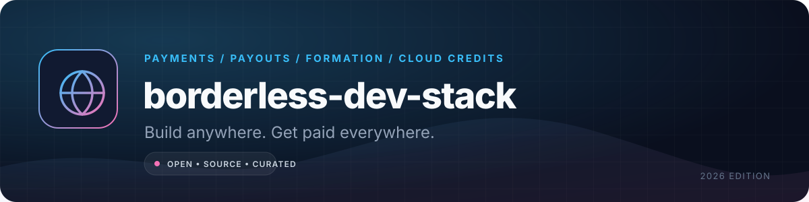

  

<h1 align="center">borderless-dev-stack</h1>

  <strong>A practical map of payments, payouts, formation, cloud credits, and compliance for developers building from anywhere.</strong> 
  Sell globally without pretending you live somewhere you do not.

  <a href="#start-with-the-constraint">Start here</a> •
  <a href="#merchant-of-record">Payments</a> •
  <a href="#payouts-and-banking">Payouts</a> •
  <a href="#formation">Formation</a> •
  <a href="#cloud-credits-and-startup-programs">Credits</a> •
  <a href="CONTRIBUTING.md">Contribute</a>

  
  
  

> **Geography is a product constraint.** Your payment provider, tax registration, bank, and cloud region can decide whether you can accept a customer at all. This guide maps the legal-ish infrastructure, not loopholes. It is education, not legal, tax, or financial advice. Availability and fees change; verify with the provider and a qualified local professional.

## Start with the constraint

Ask these five questions before choosing a company structure:

1. **Where do my customers live?** Selling digital services into the EU/UK often means VAT. Selling to US businesses may mean sales-tax nexus and W-8BEN forms.
2. **Where am I tax-resident?** A foreign company does not erase local tax obligations. Managed correctly, it can add a second filing obligation.
3. **How will money reach me?** A payment processor accepting the customer is not the same as a payout rail that works in your country.
4. **Do I need a local entity?** Some processors require a local company; some do not. A merchant of record can often work with an individual contractor.
5. **What is my risk tolerance?** Reserves, chargebacks, sanctions screening, and account freezes are part of the product.

### The three paths

| Path | Upfront cost | Ongoing cost | Best for | Trade-off |
|---|---|---|---|---|
| **Merchant of record only** | Low | 4–10% of revenue + payout fees | Solo developers validating a global product | Less control; payout thresholds; the MoR owns the customer relationship. |
| **Local company + local PSP** | Low–medium | Accounting, local taxes, compliance | Selling primarily in your own market | The PSP may not support cross-border cards or subscriptions. |
| **Foreign entity + global PSP** | $300–$5,000+ | Registered agent, filings, accounting, tax returns | A real global business with banking and hires | You must actually operate it; “set and forget” is a compliance failure. |

**Do not use a fake address, VPN, or borrowed identity to open a payment account.** It is a fast route to frozen funds and permanent processor bans. If you cannot meet a provider’s requirements, use a merchant of record or sell through a platform that already supports your region.

## Merchant of record

A **merchant of record (MoR)** is the legal seller to the end customer. It handles card processing, tax calculation/remittance in many jurisdictions, invoicing, refunds, and chargebacks, then pays you as a vendor. It is not a charity and it is not a law firm.

| Provider | Model | Best for | Watch out |
|---|---|---|---|
| [Paddle](https://www.paddle.com/) | MoR | Global B2B/B2C SaaS, subscriptions, tax compliance | Approval can be strict; payout thresholds and reserves; product review. |
| [Lemon Squeezy](https://www.lemonsqueezy.com/) | MoR (owned by Stripe) | Indie digital products and SaaS | Check current product roadmap and migration terms after the acquisition. |
| [Polar](https://polar.sh/) | MoR, developer-first | Open-source maintainers and API products | Newer ecosystem; confirm payout coverage for your country. |
| [Gumroad](https://gumroad.com/) | MoR | One-off digital products, memberships, creator sales | Fees can be high for high-volume SaaS; limited operational control. |
| [FastSpring](https://fastspring.com/) | MoR | B2B software, invoicing, global tax | Higher-touch approval and pricing; not the cheapest for tiny products. |
| [Payhip](https://payhip.com/) | MoR-style digital commerce | Simple digital downloads and memberships | Verify tax handling and payout methods for your jurisdiction. |
| [Creem](https://www.creem.io/) | MoR for software | Indie SaaS and AI products | Newer; verify licensing, payout coverage, and dispute process. |
| [Ko-fi](https://ko-fi.com/) | Creator payments | Donations, memberships, small digital shops | Not a full SaaS billing system; platform terms apply. |
| [Buy Me a Coffee](https://buymeacoffee.com/) | Creator payments | Tips, memberships, simple sales | Not a substitute for subscription tax infrastructure. |
| [Stripe](https://stripe.com/) | PSP, **not MoR** | Businesses that can own tax and entity compliance | You are the seller; you own VAT/GST/sales tax and chargebacks. |
| [PayPal](https://www.paypal.com/) | PSP, **not MoR** | Local checkout and payouts | Account risk, currency conversion, and tax ownership remain yours. |

**Read the payout section before signing up.** A 5% fee with a 60-day hold and a $500 minimum payout is worse than a 10% fee with weekly payouts when you have $200 in sales.

## Payouts and banking

| Provider | What it solves | Availability note | Best for |
|---|---|---|---|
| [Wise Business](https://wise.com/business/) | Multi-currency accounts and local receiving details | Availability varies by country | Contractors and small companies receiving USD/EUR/GBP. |
| [Payoneer](https://www.payoneer.com/) | Receiving accounts and marketplace payouts | Broad but not universal; verify supported countries | Freelancers and sellers paid by platforms. |
| [Airwallex](https://www.airwallex.com/) | Business accounts, FX, and global collections | Strong in APAC; entity requirements vary | Teams with multi-currency operations. |
| [Mercury](https://mercury.com/) | US business banking | Requires a US entity and approval | US LLC/C-corp founders. |
| [Relay](https://relayfi.com/) | US business banking | US entity required | US-based founders who want multiple accounts. |
| [Revolut Business](https://www.revolut.com/business/) | Multi-currency business accounts | EEA/UK and selected markets | European contractors and companies. |
| [Aspire](https://aspireapp.com/) | Singapore/Asia business banking | Local entity requirements | Singapore or APAC founders. |
| [Geegpay](https://geegpay.africa/) | Global accounts and payouts for African freelancers | Verify country coverage and limits | African creators and remote workers. |
| [Raenest](https://raenest.com/) | Global accounts for African talent and businesses | Verify country coverage and KYB requirements | African freelancers and startups. |
| [Grey](https://grey.co/) | Foreign-currency accounts for Africans | Verify supported countries and limits | Receiving USD/EUR/GBP payouts. |
| [Deel](https://www.deel.com/) | Contractor payments and EOR | Country-specific employment rules | Paying international contractors or hiring without an entity. |
| [Remote](https://remote.com/) | Global EOR and payroll | Country coverage varies | Hiring employees without a local entity. |
| [Oyster](https://www.oysterhr.com/) | Global employment | Country coverage varies | Mission-driven remote teams. |
| [Multiplier](https://www.usemultiplier.com/) | EOR and contractor management | Country coverage varies | APAC-heavy teams. |

**The payout chain:** customer → MoR/PSP → settlement balance → reserve/hold → FX conversion → local bank or wallet → your tax return. Every arrow can take days and cost money.

## Formation

| Option | Link | Upfront | Good for | Do not ignore |
|---|---|---|---|---|
| [Stripe Atlas](https://stripe.com/atlas) | US Delaware C-corp | ~$500 | Fundraising-track startups that need a US entity | Annual franchise tax, registered agent, US tax filings, and real US presence. |
| [doola](https://www.doola.com/) | US LLC/C-corp formation | From a few hundred USD | Non-US founders wanting a US entity | Not a substitute for local tax advice; banking is separate. |
| [Firstbase](https://www.firstbase.io/) | US company formation | From a few hundred USD | Founders who want an all-in-one dashboard | Verify what is included vs. recurring. |
| [Clerky](https://www.clerky.com/) | Startup legal paperwork | Per package | Delaware C-corps raising venture capital | Legal documents still need review. |
| [Estonia e-Residency](https://www.e-resident.gov.ee/) | EU OÜ formation | State fee + service provider | EU-facing digital businesses | E-residency is not residency or automatic tax residence. |
| [Xolo](https://xolo.io/) | Estonia OÜ administration | Monthly plan | Solo EU e-resident founders | Accounting and local tax obligations remain. |
| [UK Companies House](https://www.gov.uk/government/organisations/companies-house) | UK limited company | Low | UK-market businesses | Confirmation statements, UK tax, and a real operating presence. |
| [Delaware Division of Corporations](https://corp.delaware.gov/) | US entity direct | State fee | Founders who already have US counsel | Registered agent and annual report required. |
| [Singapore ACRA](https://www.acra.gov.sg/) | Singapore company | Moderate | APAC market and banking | A local resident director is generally required. |
| [UAE free zones](https://www.dmcc.ae/) | UAE company | Thousands of USD | Regional trade and banking | Substance, visa, and banking requirements vary by zone. |
| [Pakistan SECP](https://www.secp.gov.pk/) | Pakistan company | Local fees | Pakistani market and local banking | Cross-border payment options remain limited; plan the payout rail. |

**The uncomfortable part:** a US LLC does not make you a US tax resident, and it does not automatically give you a US bank account. It creates a US filing entity. Budget for annual compliance before you incorporate.

## Cloud credits and startup programs

| Program | Link | What you can get | Eligibility reality |
|---|---|---|---|
| [GitHub Student Developer Pack](https://education.github.com/pack) | GitHub | Free developer tools, credits, and domains | Verified student status; some offers expire. |
| [AWS Activate](https://aws.amazon.com/activate/) | AWS | Credits and technical support | Startup criteria and a valid organisation. |
| [Google for Startups Cloud](https://cloud.google.com/startup) | Google Cloud | Credits and startup support | Early-stage verification; tiered. |
| [Microsoft for Startups Founders Hub](https://www.microsoft.com/en-us/startups) | Azure/OpenAI | Credits and software benefits | Application review; tiered by stage. |
| [Cloudflare Startup Plan](https://www.cloudflare.com/forstartups/) | Cloudflare | Edge credits and support | Startup program acceptance. |
| [DigitalOcean Hatch](https://www.digitalocean.com/hatch) | DigitalOcean | Credits and community | Early-stage startup acceptance. |
| [Vercel for Startups](https://vercel.com/startups) | Vercel | Platform credits and support | Startup program acceptance. |
| [Supabase Startups](https://supabase.com/startups) | Supabase | Credits and support | Application review. |
| [MongoDB for Startups](https://www.mongodb.com/startups) | MongoDB Atlas | Credits and technical advice | Startup criteria. |
| [Neon Startups](https://neon.com/startups) | Neon Postgres | Credits and support | Application review. |
| [Sentry for Startups](https://sentry.io/for/startups/) | Sentry | Error monitoring credits | Startup program acceptance. |
| [NVIDIA Inception](https://www.nvidia.com/en-us/startups/) | NVIDIA | GPU credits, technical resources, and go-to-market | AI startup review; not a generic coupon. |
| [Twilio Startups](https://www.twilio.com/en-us/solutions/startups) | Twilio | Communications credits | Startup program acceptance. |
| [JetBrains Education](https://www.jetbrains.com/community/education/) | JetBrains | Free IDEs for students and teachers | Verified academic status. |
| [Notion for Startups](https://www.notion.com/startups) | Notion | Workspace credits | Startup criteria. |
| [Linear for Startups](https://linear.app/startups) | Linear | Project management credits | Startup criteria. |

**Credit strategy:** use credits for experiments, not for permanent architecture. A free tier that disappears after 12 months is a migration project with a deadline. Keep a cost model for the post-credit state.

## Global infrastructure and APIs

| Service | Link | Why it matters | Access check |
|---|---|---|---|
| [Stripe global](https://stripe.com/global) | Stripe | Card payments and subscriptions | Confirm your country and entity type. |
| [Paddle](https://www.paddle.com/) | Paddle | MoR for global SaaS | Payout country coverage. |
| [Polar](https://polar.sh/) | Polar | Developer-first MoR | Payout country coverage. |
| [OpenAI API](https://platform.openai.com/docs/supported-countries) | OpenAI | Model API | Supported-country list. |
| [Anthropic API](https://www.anthropic.com/supported-countries) | Anthropic | Claude API | Supported-region list. |
| [Cloudflare](https://www.cloudflare.com/) | Cloudflare | Edge compute, storage, and DNS | Account/billing country. |
| [Vercel](https://vercel.com/) | Vercel | Frontend and serverless hosting | Billing and region options. |
| [Fly.io](https://fly.io/) | Fly.io | Global app hosting | Payment method and region. |
| [Railway](https://railway.com/) | Railway | Fast app deployment | Billing country and usage limits. |
| [Render](https://render.com/) | Render | Managed web services | Billing country and region. |
| [Neon](https://neon.com/) | Neon | Serverless Postgres | Billing and data region. |
| [Supabase](https://supabase.com/) | Supabase | Postgres, auth, and storage | Billing and project region. |
| [Upstash](https://upstash.com/) | Upstash | Serverless Redis and Kafka | Billing and region. |
| [Turso](https://turso.tech/) | Turso | Edge SQLite | Billing and replication region. |
| [Resend](https://resend.com/) | Resend | Transactional email | Sending domain and region. |

**Infrastructure rule:** pick a region close to your customers and a billing method that works today. Do not assume a free-tier account will survive a move or a card change.

## Tax and compliance concepts

This section explains the vocabulary. It is not a tax return.

| Concept | What it means | Why developers get it wrong |
|---|---|---|
| [Merchant of record](https://www.paddle.com/blog/what-is-merchant-of-record) | The entity legally selling to the customer. | “Stripe is my MoR” is false; Stripe is a processor. |
| [VAT OSS](https://vat-one-stop-shop.ec.europa.eu/) | One EU VAT return for cross-border B2C sales. | Thresholds and registration rules differ by country. |
| [W-8BEN](https://www.irs.gov/forms-pubs/about-form-w-8-ben) | US withholding certificate for foreign persons. | Platforms may require it; it is not a US tax return. |
| [DAC7](https://taxation-customs.ec.europa.eu/taxation/tax-transparency-cooperation/administrative-co-operation-and-mutual-assistance/dac7_en) | EU platform reporting rules. | Marketplaces may report your sales; your local tax filing remains. |
| [GDPR](https://commission.europa.eu/law/law-topic/data-protection_en) | EU data protection framework. | A privacy policy is not a data-processing agreement or a retention policy. |
| [OFAC sanctions](https://ofac.treasury.gov/) | US sanctions screening. | Payment providers screen customers; you may still have obligations. |
| [Economic nexus](https://www.streamlinedsalestax.org/) | US sales-tax presence based on sales/transactions. | A US LLC can create filing obligations even without an office. |
| [Transfer pricing](https://www.oecd.org/tax/transfer-pricing/) | Pricing between related entities. | A foreign entity and a local company need a defensible arrangement. |

**The minimum record-keeping set:** invoices, payout statements, bank statements, contracts, tax registrations, refund/chargeback records, and a reconciliation between gross sales and net payouts. Keep them long enough for your local rules; seven years is a common benchmark, not universal.

## Remote work and talent

| Provider | What it does | Use it when |
|---|---|---|
| [Deel](https://www.deel.com/) | Contractor payments and EOR | You need to pay people in many countries without entities. |
| [Remote](https://remote.com/) | Global employment and payroll | You want a formal EOR with local benefits. |
| [Oyster](https://www.oysterhr.com/) | Global employment | You need a compliant employer of record. |
| [Multiplier](https://www.usemultiplier.com/) | EOR and contractor management | You are hiring across APAC. |
| [Velocity Global](https://velocityglobal.com/) | Global employment and immigration | You need employer services plus mobility. |
| [Atlas HXM](https://www.atlashxm.com/) | Direct EOR | You want an alternative EOR with local entities. |

**Contractor vs employee:** a contract that says “contractor” does not make someone a contractor. Local law tests control, exclusivity, and integration. Misclassification is expensive.

## Communities and ongoing learning

| Community | Link | Why join |
|---|---|---|
| Indie Hackers | [indiehackers.com](https://www.indiehackers.com/) | Revenue transparency and distribution lessons. |
| Hacker News | [news.ycombinator.com](https://news.ycombinator.com/) | Launch feedback and technical critique. |
| r/indiehackers | [reddit.com/r/indiehackers](https://www.reddit.com/r/indiehackers/) | Small-founder tactics and questions. |
| r/SideProject | [reddit.com/r/SideProject](https://www.reddit.com/r/SideProject/) | Early feedback and launch threads. |
| Product Hunt | [producthunt.com](https://www.producthunt.com/) | Launch distribution, with diminishing returns. |
| MicroConf | [microconf.com](https://microconf.com/) | Bootstrapped SaaS strategy and founder community. |
| Indie Worldwide | [indieworldwide.com](https://indieworldwide.com/) | Global indie founder network. |
| Women Make | [womenmake.com](https://womenmake.com/) | Community for women building products. |

## The launch checklist

- [ ] I can explain who the legal seller is and where tax is remitted.
- [ ] I have tested a real payout to my own bank account, not just a test charge.
- [ ] I know the reserve, hold, refund, and chargeback rules.
- [ ] I have a refund policy and terms that match the checkout flow.
- [ ] I have a privacy policy, data-retention rule, and a deletion path.
- [ ] I know my local income-tax and registration obligations.
- [ ] I have a second payout method and a backup bank account.
- [ ] I have a plan for a frozen account: export customer data and communicate.
- [ ] I have not claimed a US/EU presence I do not have.
- [ ] I have budgeted for accounting and annual filings, not just incorporation.

## How entries are selected

- The provider must publish terms, supported countries, and a usable self-serve path.
- Fees and availability are described as ranges unless verified on the provider page at review time.
- No referral links, affiliate codes, or “incorporate here” kickbacks.
- Providers with predatory terms, fake address schemes, or unclear licensing are excluded.
- Regional coverage is a feature, not an afterthought.

## Contributing

Add a provider, correct a coverage note, or share a primary source through [CONTRIBUTING.md](CONTRIBUTING.md). Include the country, entity type, and date you verified the detail.

## License and disclaimer

Original text is released under the [MIT License](LICENSE). This repository is educational and does not provide legal, tax, accounting, or financial advice. Consult a qualified professional in your jurisdiction before incorporating, changing your tax residence, or signing a payment contract.

---

**Last reviewed: 2026-11-03.** Prices, metrics, licences, and availability change; verify against the linked upstream source before relying on them.
